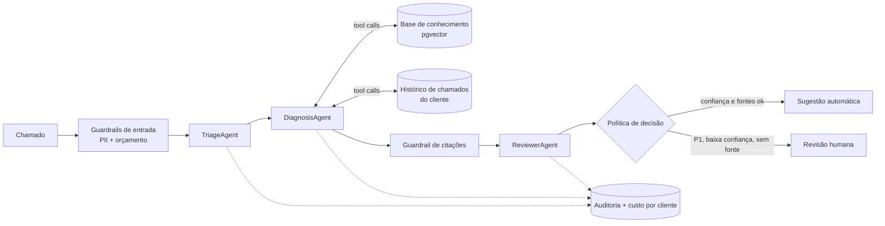

# AMS Copilot

Agentes de IA que apoiam a operação de AMS SAP: triagem e diagnóstico de chamados, análise de recorrência e causa raiz, e geração de documentação técnica a partir de uma base de conhecimento.

O foco não é só "chamar um LLM", e sim o que torna isso utilizável em produção: respostas ancoradas em fontes (RAG), guardrails, trilha de auditoria de cada ação da IA, controle de custo de tokens por cliente e avaliação contínua de qualidade com gate no CI.

## O que ele faz

| Capacidade | Como está implementado |
| --- | --- |
| Triagem de chamados | `TriageAgent` classifica módulo SAP (FI, CO, MM, SD, PP, BASIS, ABAP, INTEGRATION, SECURITY, FISCAL), prioridade (P1 a P4) e tipo, com confiança declarada |
| Diagnóstico com RAG | `DiagnosisAgent` usa ferramentas (`search_knowledge_base`, `find_similar_tickets`) e só pode citar documentos que a busca realmente retornou |
| Revisão antes do analista | `ReviewerAgent` reprova diagnóstico sem fonte, com citação inventada ou com confiança incompatível com a evidência |
| Recorrência e causa raiz | `TicketHistory.recurrence` agrupa chamados do cliente por similaridade e módulo e aponta a causa raiz dominante para abrir registro de problema |
| Documentação técnica | `DocumentationAgent` transforma um chamado resolvido em artigo da base de conhecimento em Markdown |
| Guardrails | mascaramento de CPF, CNPJ, e-mail e telefone antes de qualquer chamada ao modelo; limite de confiança; P1 sempre vai para humano; bloqueio de transações perigosas; descarte de citações não recuperadas; orçamento diário de tokens por cliente |
| Auditoria | cada chamada de ferramenta, saída inválida, conclusão de agente e decisão final fica registrada por chamado (`/v1/tickets/{id}/audit`) |
| Custo por cliente | tokens e custo em USD por agente e por modelo, com custo médio por chamado (`/v1/tenants/{tenant}/usage`) |
| Avaliação | dataset rotulado em `evals/dataset.jsonl`, métricas de acurácia, hit rate da busca, precisão de citação, taxa de automação, tokens, custo e latência, com gate no CI |
| MCP | servidor MCP expõe busca, triagem, recorrência, consumo e auditoria para qualquer cliente compatível |

## Arquitetura



- `src/ams_copilot/agents`: agente genérico com loop de ferramentas, validação de saída por schema Pydantic e nova tentativa quando o modelo foge do formato.
- `src/ams_copilot/rag`: chunking por seção, embeddings, `InMemoryVectorStore` e `PgVectorStore` (índice HNSW por distância de cosseno), histórico de chamados e detecção de recorrência.
- `src/ams_copilot/llm`: cliente compatível com a API de Chat Completions (OpenAI, Ollama, vLLM e provedores compatíveis) e um modo offline determinístico, usado em testes e no CI.
- `src/ams_copilot/guardrails.py`, `audit.py`, `pricing.py`: políticas, trilha de auditoria e custo.
- `src/ams_copilot/api.py` e `mcp_server.py`: interfaces HTTP e MCP sobre o mesmo pipeline.

## Rodando

```bash
python -m venv .venv && source .venv/bin/activate
pip install -e ".[dev]"

pytest -q
ams-copilot eval
ams-copilot triage --tenant cliente-alfa \
  --title "Pedidos do portal parados" \
  --description "IDoc ORDERS em status 51, material sem centro"
ams-copilot serve
```

Sem variáveis de ambiente o projeto roda em modo offline: embeddings por hashing e um modelo determinístico que segue o mesmo protocolo de mensagens e tool calls de um LLM real. Isso permite testar o pipeline inteiro sem chave de API e sem custo. Para usar um modelo de verdade, copie `.env.example` para `.env` e preencha o provedor.

Com PostgreSQL e pgvector:

```bash
cp .env.example .env
docker compose up --build
curl -s localhost:8000/health
```

## API

```bash
curl -s -X POST localhost:8000/v1/tickets/triage \
  -H "Content-Type: application/json" \
  -d '{"tenant": "cliente-beta", "title": "Faturamento bloqueado", "description": "Remessa bloqueada por limite de crédito na VF01"}'

curl -s localhost:8000/v1/tickets/{ticket_id}/audit
curl -s localhost:8000/v1/tenants/cliente-beta/usage?days=30
curl -s localhost:8000/v1/tenants/cliente-alfa/recurrence
curl -s -X POST localhost:8000/v1/kb/search -H "Content-Type: application/json" -d '{"query": "spool com erro"}'
```

Resposta resumida de uma triagem:

```json
{
  "triage": {"module": "INTEGRATION", "priority": "P3", "confidence": 0.95},
  "diagnosis": {
    "probable_cause": "Dados mestre ausentes ou divergentes entre o sistema emissor e o SAP ...",
    "sap_transactions": ["WE02", "WE19", "BD87", "WE20"],
    "citations": ["KB-001"],
    "confidence": 0.75
  },
  "review": {"approved": true, "issues": []},
  "similar_tickets": ["ALF-1001", "ALF-1015", "ALF-1007"],
  "route": "auto_suggest",
  "usage": {"prompt_tokens": 2409, "completion_tokens": 358, "cost_usd": 0.0}
}
```

A API inicia em `127.0.0.1` pelo CLI. Sem `AMS_TENANT_API_KEYS`, opera em modo local confiável, sem autenticação. Para acesso compartilhado, configure `AMS_TENANT_API_KEYS` como um objeto JSON que mapeia cada cliente a uma chave secreta única de pelo menos 32 caracteres e envie `Authorization: Bearer <chave>` em todas as rotas `/v1`. O cliente autenticado só pode consultar seu consumo, recorrências e auditoria, ou processar seus próprios chamados. `/health` permanece público. A base de conhecimento é compartilhada entre clientes e deve conter apenas conteúdo comum.

Use TLS e limites de requisições/conexões e tamanho do corpo no proxy de entrada. Títulos aceitam até 500 caracteres, descrições e buscas até 20 mil, buscas retornam de 1 a 20 documentos e relatórios cobrem de 1 a 366 dias. Falha do provedor na triagem ou documentação retorna HTTP 502; falhas no diagnóstico ou revisão encaminham para análise humana. Conexões HTTP usam timeout de 60 segundos, sem repetição automática de chamadas cobradas. `AMS_LLM_MAX_OUTPUT_TOKENS` limita cada resposta do provedor a 2048 tokens por padrão (parâmetro `max_tokens` da API compatível).

O mascaramento por padrões cobre CPF, CNPJ, e-mail e telefone em entradas de agentes, resultados de ferramentas, payloads de auditoria e textos enviados ao provedor de embeddings. Não é uma solução geral de anonimização: identificadores de cliente/chamado são preservados na auditoria. Instruções de conteúdo recuperado não têm autoridade sobre os agentes; essa proteção por prompt não garante imunidade a injeção. O modo offline usa heurísticas e não valida semanticamente as recomendações.

## Servidor MCP

```json
{
  "mcpServers": {
    "ams-copilot": {
      "command": "ams-copilot",
      "args": ["mcp"],
      "env": {"AMS_LLM_PROVIDER": "openai", "AMS_LLM_API_KEY": "..."}
    }
  }
}
```

Ferramentas expostas: `search_knowledge_base`, `triage_ticket`, `ticket_recurrence`, `tenant_usage` e `ticket_audit_trail`. O transporte é stdio e o processo herda a confiança do usuário local. Configure `AMS_MCP_TENANT` para restringir o processo a um cliente; sem essa variável, ele mantém acesso administrativo aos clientes. As chaves HTTP não autenticam clientes MCP.

## Avaliação

`ams-copilot eval` roda os 20 chamados rotulados de `evals/dataset.jsonl` pelo pipeline completo e falha se a acurácia de módulo ou o hit rate da busca ficarem abaixo do limite. O mesmo comando roda no CI e publica o relatório como artefato.

Resultado no modo offline:

| Métrica | Valor |
| --- | --- |
| Acurácia de módulo | 0.95 |
| Acurácia de prioridade | 1.00 |
| Hit rate da busca (top 4) | 1.00 |
| Precisão de citação | 0.95 |
| Sugestão automática (restante vai para humano) | 0.75 |
| Tokens por chamado | ~3 mil |

A precisão de citação conta cada citação individual contra o documento esperado, incluindo citações extras ou presentes em casos sem fonte esperada. O revisor recebe o conteúdo recuperado, além dos IDs.

O caso que falha (uma dúvida sobre consulta de períodos de materiais) é mantido de propósito: o relatório lista cada erro com o esperado e o obtido, que é o que orienta a próxima melhoria. Ao trocar para um modelo real, o mesmo dataset mede o ganho de qualidade contra o aumento de custo por chamado.

## Decisões de projeto

- **Citações verificáveis**: o pipeline guarda os documentos que a busca devolveu e descarta qualquer citação fora desse conjunto antes da revisão. Diagnóstico sem fonte nunca sai como sugestão automática.
- **Humano no circuito por política, não por acaso**: P1, baixa confiança, revisor reprovando ou transação bloqueada mandam o chamado para revisão humana, com os motivos explícitos na resposta.
- **Dado pessoal não sai do perímetro**: o texto é mascarado antes de chegar a qualquer agente, e a auditoria registra só a contagem do que foi mascarado.
- **Custo como requisito**: cada chamada ao modelo grava tokens e custo por cliente, agente e modelo, e o orçamento diário por cliente é verificado antes de cada chamada ao modelo, incluindo documentação (HTTP 429 quando esgota). O consumo da chamada em andamento pode exceder o saldo; chamadas concorrentes ainda não fazem reserva atômica de tokens. Embeddings não entram nesse orçamento.
- **Provedor intercambiável**: o mesmo código fala com OpenAI, Ollama, vLLM ou qualquer provedor compatível pela API de Chat Completions.

## Próximos passos

- Conector com ITSM (ServiceNow, Jira Service Management) para ler e atualizar chamados.
- Avaliação de qualidade de resposta com LLM como juiz e comparação entre modelos no mesmo dataset.
- Feedback do analista (aceitou ou corrigiu a sugestão) alimentando o dataset de avaliação.
- Reranking na busca e indexação incremental da base de conhecimento.

## Licença

MIT
